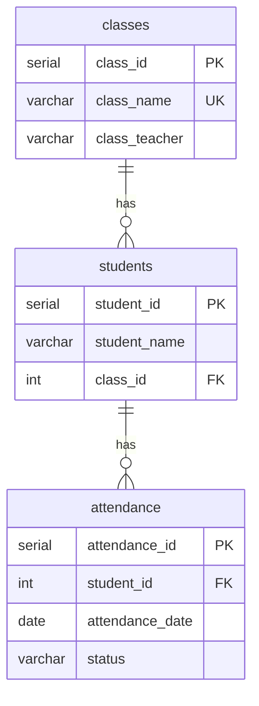

# School Student Attendance Database Normalization Using SQL

**Case Study 148: School Attendance Management** | Syllabus focus: Normalization

A PostgreSQL project that redesigns a school's single-table attendance record into a normalized relational database (`students`, `classes`, `attendance`) and applies 1NF, 2NF and 3NF.

---

## Table of Contents

- [Problem Statement](#problem-statement)
- [Objectives](#objectives)
- [Tech Stack](#tech-stack)
- [Database Design](#database-design)
- [Getting Started](#getting-started)
- [SQL Queries](#sql-queries)
- [Normalization Explained](#normalization-explained)
- [Project Structure](#project-structure)
- [Author](#author)

---

## Problem Statement

A school stores student names, class information and attendance details in one large record structure. This repeats the same student and class information in every row. The database must be redesigned using normalization principles.

## Objectives

- Identify the repeating information in the original design.
- Decompose the system into **students**, **classes** and **attendance** tables.
- Make sure each table represents one logical entity.
- Create the normalized tables and insert the sample records.
- Display attendance for a selected student.
- Calculate the attendance percentage for each student.
- Explain how 1NF, 2NF and 3NF are applied.

## Tech Stack

| Item | Details |
|------|---------|
| Database | PostgreSQL |
| Client | pgAdmin (Query Tool + ERD Tool) |
| Database name | `school_attendance` |
| Language | SQL (DDL, DML, joins, aggregates) |

## Database Design

### Original (unnormalized) table

`attendance_raw` holds everything in one table, so the class and teacher details are repeated for every attendance row.

| record_id | student_name | class_name | class_teacher | attendance_date | status |
|-----------|--------------|------------|---------------|-----------------|--------|
| 1 | Riya | 10-A | Mrs. Sharma | 2024-07-01 | Present |
| 2 | Riya | 10-A | Mrs. Sharma | 2024-07-02 | Present |
| 3 | Arjun | 10-A | Mrs. Sharma | 2024-07-01 | Present |
| 4 | Arjun | 10-A | Mrs. Sharma | 2024-07-02 | Absent |
| 5 | Simran | 10-B | Mr. Verma | 2024-07-01 | Absent |
| 6 | Simran | 10-B | Mr. Verma | 2024-07-02 | Present |

> Teacher names and the Present/Absent values are illustrative sample data.

### Normalized design



| Table | Columns |
|-------|---------|
| `classes` | `class_id` (PK), `class_name` (UNIQUE), `class_teacher` |
| `students` | `student_id` (PK), `student_name`, `class_id` (FK → classes) |
| `attendance` | `attendance_id` (PK), `student_id` (FK → students), `attendance_date`, `status` |

## Getting Started

1. Install PostgreSQL and pgAdmin.
2. Create the database:
   ```sql
   CREATE DATABASE school_attendance;
   ```
3. Connect to `school_attendance` in pgAdmin and open the Query Tool.
4. Run the scripts below in order.

## SQL Queries

### 1. Original table and sample data

```sql
CREATE TABLE attendance_raw (
    record_id       SERIAL PRIMARY KEY,
    student_name    VARCHAR(50),
    class_name      VARCHAR(10),
    class_teacher   VARCHAR(50),
    attendance_date DATE,
    status          VARCHAR(10)
);

INSERT INTO attendance_raw (student_name, class_name, class_teacher, attendance_date, status) VALUES
('Riya',   '10-A', 'Mrs. Sharma', '2024-07-01', 'Present'),
('Riya',   '10-A', 'Mrs. Sharma', '2024-07-02', 'Present'),
('Arjun',  '10-A', 'Mrs. Sharma', '2024-07-01', 'Present'),
('Arjun',  '10-A', 'Mrs. Sharma', '2024-07-02', 'Absent'),
('Simran', '10-B', 'Mr. Verma',   '2024-07-01', 'Absent'),
('Simran', '10-B', 'Mr. Verma',   '2024-07-02', 'Present');
```

### 2. Show the repeating groups

```sql
SELECT student_name, class_name, class_teacher, COUNT(*) AS times_repeated
FROM   attendance_raw
GROUP  BY student_name, class_name, class_teacher
HAVING COUNT(*) > 1;
```

### 3. Create the normalized tables

```sql
CREATE TABLE classes (
    class_id      SERIAL PRIMARY KEY,
    class_name    VARCHAR(10) NOT NULL UNIQUE,
    class_teacher VARCHAR(50) NOT NULL
);

CREATE TABLE students (
    student_id    SERIAL PRIMARY KEY,
    student_name  VARCHAR(50) NOT NULL,
    class_id      INTEGER NOT NULL REFERENCES classes(class_id)
);

CREATE TABLE attendance (
    attendance_id   SERIAL PRIMARY KEY,
    student_id      INTEGER NOT NULL REFERENCES students(student_id),
    attendance_date DATE NOT NULL,
    status          VARCHAR(10) NOT NULL CHECK (status IN ('Present', 'Absent')),
    UNIQUE (student_id, attendance_date)
);
```

### 4. Insert records into the normalized tables

```sql
INSERT INTO classes (class_name, class_teacher)
SELECT DISTINCT class_name, class_teacher
FROM   attendance_raw;

INSERT INTO students (student_name, class_id)
SELECT DISTINCT r.student_name, c.class_id
FROM   attendance_raw r
JOIN   classes c ON c.class_name = r.class_name;

INSERT INTO attendance (student_id, attendance_date, status)
SELECT s.student_id, r.attendance_date, r.status
FROM   attendance_raw r
JOIN   students s ON s.student_name = r.student_name;
```

### 5. Display attendance for a selected student

```sql
SELECT s.student_name, c.class_name, a.attendance_date, a.status
FROM   students s
JOIN   classes c    ON c.class_id   = s.class_id
JOIN   attendance a ON a.student_id = s.student_id
WHERE  s.student_name = 'Riya'
ORDER  BY a.attendance_date;
```

| student_name | class_name | attendance_date | status |
|--------------|------------|-----------------|--------|
| Riya | 10-A | 2024-07-01 | Present |
| Riya | 10-A | 2024-07-02 | Present |

### 6. Attendance percentage for each student

```sql
SELECT s.student_name,
       c.class_name,
       COUNT(*)                                      AS total_days,
       COUNT(*) FILTER (WHERE a.status = 'Present')  AS days_present,
       ROUND(100.0 * COUNT(*) FILTER (WHERE a.status = 'Present')
             / COUNT(*), 2)                          AS attendance_pct
FROM   students s
JOIN   classes c    ON c.class_id   = s.class_id
JOIN   attendance a ON a.student_id = s.student_id
GROUP  BY s.student_id, s.student_name, c.class_name
ORDER  BY s.student_name;
```

| student_name | class_name | total_days | days_present | attendance_pct |
|--------------|------------|-----------|--------------|----------------|
| Arjun | 10-A | 2 | 1 | 50.00 |
| Riya | 10-A | 2 | 2 | 100.00 |
| Simran | 10-B | 2 | 1 | 50.00 |

## Normalization Explained

Dependencies in the original data:

- `student_name → class_name`
- `class_name → class_teacher`
- `(student_name, attendance_date) → status`

| Normal Form | Issue in `attendance_raw` | How it was resolved |
|-------------|---------------------------|---------------------|
| **1NF** | Needs atomic values and a unique key per row | Atomic columns; every table has its own primary key |
| **2NF** | `class_name` and `class_teacher` depend only on `student_name`, which is part of the key (partial dependency) | Separate `students` table; attendance links by `student_id` |
| **3NF** | `class_teacher` depends on `class_name`, not on the student (transitive dependency) | Separate `classes` table; students link by `class_id` |

Result: class and student details are stored once, which removes the update, insertion and deletion anomalies of the original design.

## Project Structure

```
.
├── README.md
├── school_attendance.sql                          # all SQL scripts above, in order
└── School_Attendance_Normalization_Report.pdf     # full project report
```

## Author

**Yuvraj Mishra**
Roll No: 150096725036 | Cohort: Jeff Bezos
B.Tech CSE (2025–29), ITM Skills University
